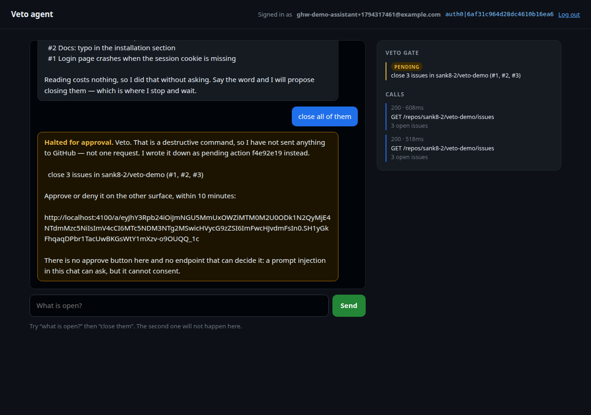
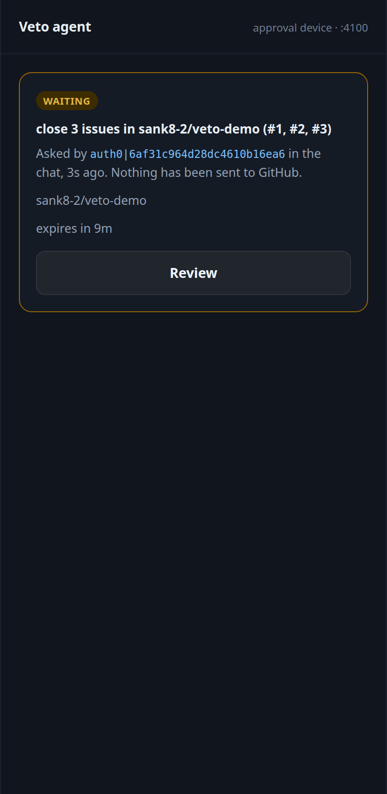
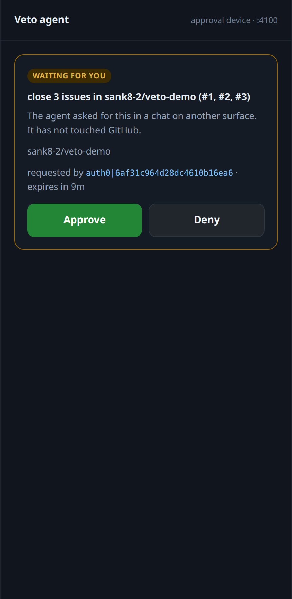
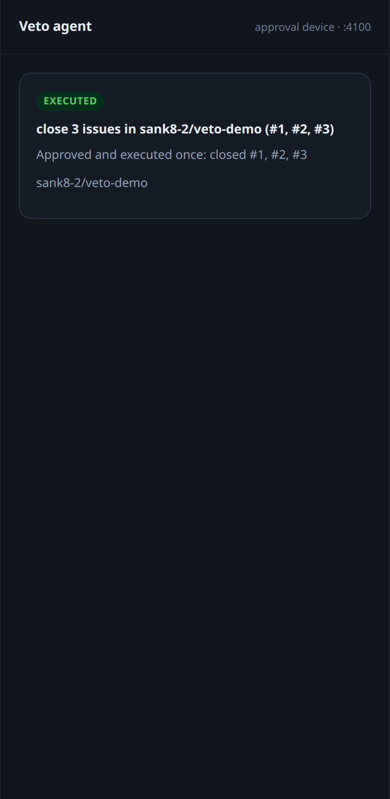
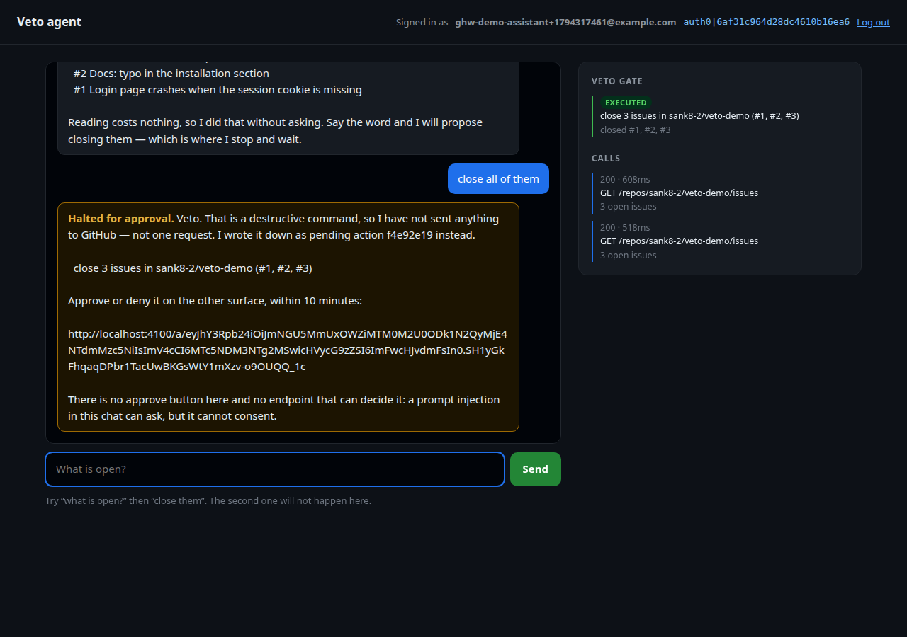

# Veto agent

A GitHub agent that answers questions immediately and refuses to act on them.
Ask what is open and it reads GitHub straight away. Tell it to close the issues
and it stops: nothing is sent, a pending row is written, and the only way
forward is a single-use link on a **second surface** — a different port, a
different process, a different page, with no shared session.

Built for Global Hack Week: Builders Week, Auth0 challenge #22
(Token Vault & Asynchronous Authorization).



## The flow

```
                    ┌──────────────────────────────┐
   chat :3000 ──────│  "close all of them"         │
   (Auth0 login)    └──────────────┬───────────────┘
                                   │
                    reads GitHub first, to freeze the target list
                                   │  GET /repos/{repo}/issues        ← allowed
                                   ▼
                    ┌──────────────────────────────┐
                    │  actions row: status=pending │
                    └──────────────┬───────────────┘
                                   │  NO write. Not one request.
                                   │
                    signed, expiring link (HMAC, 10 min)
                                   │
   phone :4100 ────── GET /a/<token>   Approve │ Deny
   (no session)                     │
                                   ▼
                    conditional UPDATE … WHERE status='pending'
                                   │  exactly one caller wins
                                   ▼
                    PATCH /repos/{repo}/issues/{n}   ← the only write
```

The chat has no approve button, no `/api/decide`, and no code path that can
move a row. `tests/test_app.py::test_the_chat_has_no_route_that_can_decide`
posts to four plausible decision endpoints and asserts a 404 from each, then
checks that the action is still pending and GitHub still untouched.

## What is real, and what is a stand-in

The challenge asks for two Auth0 features. Both are gated on this tenant, and
the honest thing is to say so rather than pretend:

| Asked for | Status here | Evidence |
| --- | --- | --- |
| **CIBA** (asynchronous authorization) | Tenant advertises `/bc-authorize`, but the grant is not enabled for the application | `{"error":"invalid_request","error_description":"CIBA grant type must be enabled"}` |
| **Token Vault** | Grant type not enabled for the application; no connected Google/GitHub/Slack account exists to vault | `{"error":"unauthorized_client","error_description":"Grant type 'urn:auth0:params:oauth:grant-type:token-exchange:federated-connection-access-token' not allowed for the client."}` |

Auth0's documentation is explicit that CIBA needs more than a free tenant:

> To use Client-Initiated Backchannel Authentication (CIBA) features, you must
> have an Enterprise Plan or an appropriate add-on.
> — [Client-Initiated Backchannel Authentication Flow](https://auth0.com/docs/get-started/authentication-and-authorization-flow/client-initiated-backchannel-authentication-flow)

The application also has no Management API grant (`Client "…" is not authorized
to access resource server "…/api/v2/"`), so none of this could be switched on
from code. What is therefore **not** real here: Auth0 does not push the
approval, and the GitHub token is a fine-grained personal token in the server's
environment rather than a token fetched from Token Vault at approval time.

What **is** real, and is the behavioural half of the success criteria:

- a real Auth0 Universal Login (Authorization Code + PKCE) identifies the user;
- a real GitHub REST call fetches the issues, and a real `PATCH` closes them;
- the sensitive command genuinely halts before any write;
- the approval genuinely arrives on another surface, and the action genuinely
  cannot happen twice.

Swapping in CIBA later is a small change: the pending row and the single-use
decision already exist, so `propose()` would call `/bc-authorize` and the phone
page would be replaced by Auth0's push to the user's authenticator.

## The verified run

Not a stub, and not a recording of one. A real login, a real repository
(`sank8-2/veto-demo`), and three real issues.

| Step | Result |
| --- | --- |
| Universal Login | `https://<tenant>.us.auth0.com/u/login`, PKCE `S256` |
| Session subject | `auth0\|6af31c964d28dc4610b16ea6` |
| "what is open?" | `GET /repos/sank8-2/veto-demo/issues` → 200 in 608 ms, 3 issues |
| "close all of them" | pending action `f4e92e19`, **zero** GitHub writes |
| Phone inbox | "close 3 issues in sank8-2/veto-demo (#1, #2, #3)", expires in 9m |
| Approve | executed 5 s after the request: `closed #1, #2, #3` |
| GitHub afterwards | all three issues `closed` |
| Replaying the same link | "This link was already used" — status still `executed`, no second write |

Screenshots, in order: the halt, the inbox, the decision, the result on the
phone, and the chat panel catching up on its own.

| | |
| --- | --- |
|  |  |
|  |  |

## The four decisions worth defending

**The write is frozen at proposal time.** The agent reads the open issues
*before* it asks, and stores the exact numbers in the pending row. Approving
later closes those issues, not "whatever is open when someone clicks" — so a
new issue filed during the wait is not silently swept up.

**A pending row is the veto, and it is a conditional update.** `decide` is
`UPDATE … WHERE id = ? AND status = 'pending'`, and its row count is the
permission slip. Two approvals racing each other produce one winner; a replay
of a used link finds nothing to move. That is why "single-use" is a property of
the database rather than of the token: the token is not burned, the row is.

**The link is signed, not stored.** The token carries only the action id, signed
with the server's HMAC key and expiring with the request. There is no session
token table to leak, and a link the user invents fails verification.

**The chat cannot decide, even if it is told to.** The decision endpoint lives
in a different module on a different port with no session cookie. The strongest
form of this guarantee is structural: `app.py` never imports `approvals.mint`,
so it cannot even produce a working link.

## Tests

```
$ .venv/bin/python -m pytest -q
61 passed
```

- `tests/test_store.py` — the row lifecycle, including that a decided row can
  never be decided again and that expiry only touches pending rows.
- `tests/test_approvals.py` — a token signed with another key, a tampered
  token, a swapped signature, an expired token, and a token minted for a
  different purpose are all refused.
- `tests/test_agent.py` — the asymmetry itself: reads go through, writes do not;
  approval executes once; denial never reaches GitHub; a failed `PATCH` is
  recorded as failed rather than swallowed.
- `tests/test_phone.py` — the approval device over a real socket: inbox, decision
  page, approve, deny, forged link, expired request, replay.
- `tests/test_app.py` — the chat over a real socket: a turn, a halt, and no route
  that can decide.

## Run it

```bash
cp .env.example .env          # Auth0 Regular Web App, callback http://localhost:3000/callback
python -m venv .venv && .venv/bin/pip install -e ".[dev]"

.venv/bin/python -m veto_agent            # chat :3000 and approval device :4100
```

Then open <http://localhost:3000>, sign in, ask "what is open in owner/name?",
and ask it to close something. Open <http://localhost:4100> on another device —
or in a narrow window — to answer.

The two surfaces can also run as separate processes, which is the point:

```bash
.venv/bin/python -m veto_agent --only chat
.venv/bin/python -m veto_agent --only phone
```

They share one SQLite file (`ACTIONS_DB`), which is how a decision made on one
shows up on the other within a second and a half.

## Layout

| File | What it is |
| --- | --- |
| `veto_agent/agent.py` | The gate: read, propose, decide, execute |
| `veto_agent/store.py` | The pending row and its one-way transitions |
| `veto_agent/approvals.py` | The signed, expiring approval token |
| `veto_agent/phone.py` | The approval device: inbox and decision page |
| `veto_agent/app.py` | The chat: Universal Login and the read-only veto panel |
| `veto_agent/github.py` | Issues and issue closing, with the token server-side only |
| `veto_agent/oidc.py`, `pkce.py`, `session.py` | The login |
